<div align="center">

# FraudNet &nbsp;|&nbsp; [Live App](https://insurance-fraud-network-detection-kwxi3ptyqgqtvulnubi7bo.streamlit.app/)

Finding insurance fraud rings, the groups of people who quietly share bank accounts, phones and stories,<br/>
without mistaking ordinary families for criminals.

<br/>

**[Run it locally](#9-run-it-yourself)** &nbsp;·&nbsp;
**[How it works](#4-how-the-detector-thinks)** &nbsp;·&nbsp;
**[Results](#6-results)** &nbsp;·&nbsp;
**[Documentation](#10-reference)**

<br/>

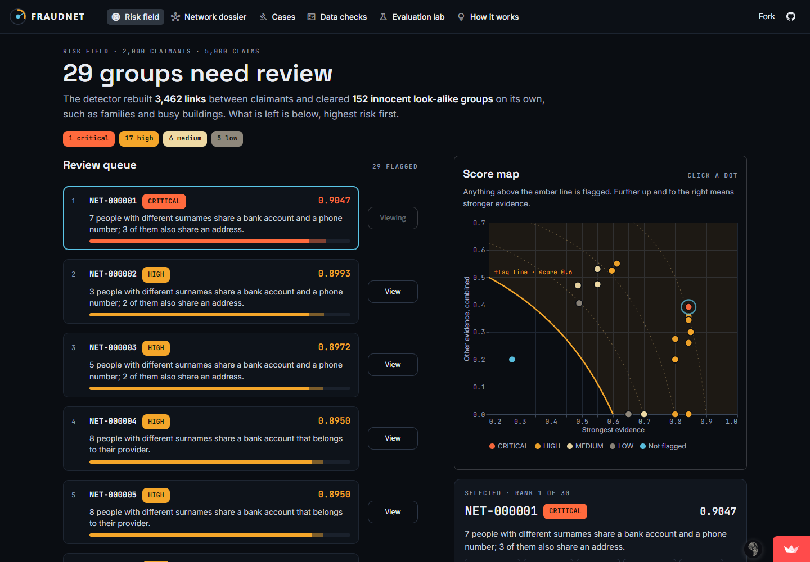

<sub>The investigator's first screen: the groups that need a human, highest risk first, each with a one-line reason.</sub>

</div>

<br/>

## Contents

1. [The problem](#1-the-problem)
2. [What we built](#2-what-we-built)
3. [The data](#3-the-data)
4. [How the detector thinks](#4-how-the-detector-thinks)
5. [Versions: what broke and how it was fixed](#5-versions-what-broke-and-how-it-was-fixed)
6. [Results](#6-results)
7. [The app](#7-the-app)
8. [Key decisions](#8-key-decisions)
9. [Run it yourself](#9-run-it-yourself)
10. [Reference](#10-reference)

---

## 1. The problem

An insurer pays thousands of claims, and most are honest. The costly fraud isn't one liar but a **ring**: a few people filing claims that look normal one by one, while secretly sharing an account, a phone, a body shop or a story. You only see a ring by **connecting the dots** between claimants, policies, incidents, providers and payments.

The difficulty is that most connected dots are innocent:

| People who share... | ...are usually |
|---|---|
| An address | A family, or neighbours in a large building |
| A phone or an account | One household |
| A repair shop | Customers of the busiest shop in town |
| Similar stories in the same week | Victims of the same storm |

Flagging everyone who shares anything buries investigators: we measured it, and **fewer than 1 in 10** of those flags are real fraud.

So the job is to **link everything, explain away the innocent reasons, and show only what is left, with evidence a person can check.** The full brief is in [docs/problem_statement.md](docs/problem_statement.md).

---

## 2. What we built

Five parts, each feeding the next, plus an app for the investigator.

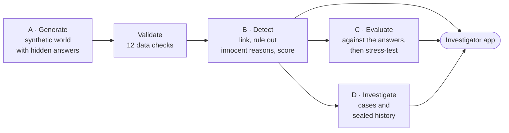

| Part | What it does | Code |
|---|---|---|
| A · Generator | Builds a seeded insurance world with fraud rings, innocent look-alikes and five edge cases. The answers go to a separate hidden file. | `src/fraudnet/generate/` |
| Validation | Checks keys, joins, dates, sums and lifecycles, and reports rule-breaking records as exceptions. | `src/fraudnet/validate/` |
| B · Detector | Finds suspicious groups from raw data alone, and is automatically blocked from reading the answers. | `src/fraudnet/detect/` |
| C · Evaluation | The only part that reads the answers. It measures precision, recall and false alarms, then stress-tests. | `src/fraudnet/evaluate/` |
| D · Investigation | Opens cases, enforces who may decide what, and keeps a history that can't be edited. | `src/fraudnet/investigate/` |
| App | Six pages: queue, dossier, cases, data checks, evaluation, explainer. | `src/fraudnet/app/` |

---

## 3. The data

One seed (`20261022`) builds **2,000 claimants, 2,600 policies, 5,000 claims, 500 providers and 12,560 recorded relationships**. Parents always come before children, every total is calculated rather than invented, and the same seed always gives byte-identical files.

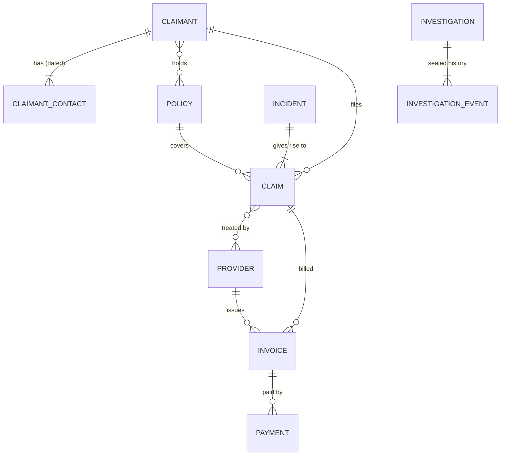

Hidden in that world, each label written by a documented rule to `hidden/ground_truth.csv`:

| What is hidden | How many |
|---|---|
| Fraud rings in six patterns (shared contacts, repeated stories, suspicious timing, provider collusion, staged crashes, links missing from the records) | 24 |
| Innocent look-alike groups (families, honest repeat claimants, movers, busy buildings, storms, popular providers) | about 400 |
| Required edge cases: missing policy (EC-1), overpayment (EC-2), duplicate invoice (EC-3), links missing from the register (EC-4), a busy address that must not count as proof (EC-5) | 5 kinds |

Every table and field: [docs/DATA_DICTIONARY.md](docs/DATA_DICTIONARY.md).

---

## 4. How the detector thinks

Raw records go in; a ranked list of explained groups comes out. Each step exists because a simpler approach failed.

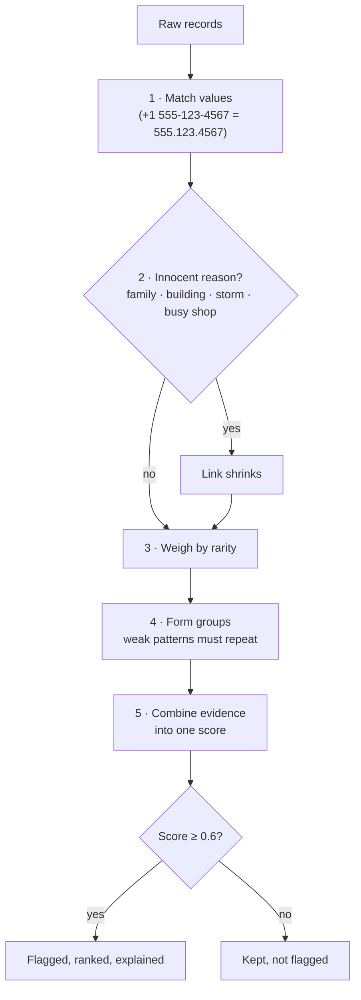

### Example: the top-ranked group

How **NET-000001** reaches a score of **0.9047**:

| Step | What the detector finds |
|---|---|
| 1 · Match | 7 people with 7 different surnames share one bank account and one phone; 3 of them also share an address |
| 2 · Innocent reason? | Different surnames, so not a family. 3 residents, so not a busy building. The shop isn't busy. **None applies** |
| 3 · Rarity | Only 3.2% of people share an account like this, so the link keeps nearly full weight: 0.85 × 0.992 = **0.843** |
| 4 · Combine | Doubt left after each kind of evidence: 1 → 0.157 → 0.136 → 0.095, so the score is 1 − 0.095 = **0.9047** |

The timeline then gives a human the reason to look closer: **all seven reported an incident on the same day**.

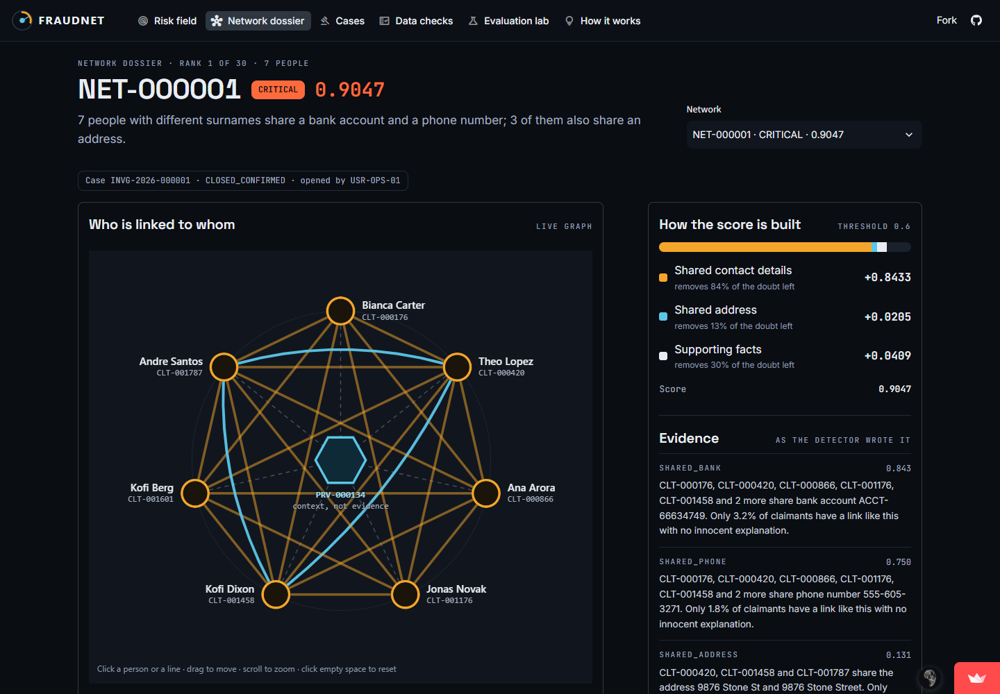

<details>
<summary><b>The seven principles behind the detector</b></summary>

<br/>

| # | Principle | Why |
|---|---|---|
| P1 | Rebuild links from raw values; never trust the relationship register as given | The register is incomplete on purpose (EC-4): 45 of the top ring's links were missing |
| P2 | Shared identifiers are strong evidence; shared addresses are weak | Many strangers share a building; few share an account |
| P3 | Explain away innocent causes before anything counts | Families, buildings, storms and busy shops cause most coincidences |
| P4 | A shared provider counts only alongside a shared anomaly | Everyone uses the popular body shop |
| P5 | Weak patterns must repeat in 3 or more people | Two similar stories can be chance; seven can't |
| P6 | Rarity sets the weights, from the data, never from the answers | A link 3% of people have says more than one 20% have |
| P7 | Groups form only from evidence; oversized groups are split (Louvain) | Context must never chain strangers together |

The score is a *noisy-OR*: score = 1 − Π(1 − fᵢ). Each kind of evidence removes part of the remaining doubt, so independent evidence reinforces without ever passing 1. Full theory and every threshold: [docs/ARCHITECTURE.md](docs/ARCHITECTURE.md).

</details>

---

## 5. Versions: what broke and how it was fixed

Perfect scores are easy when you write both the test and the answer, so we tried hard to break our own detector.

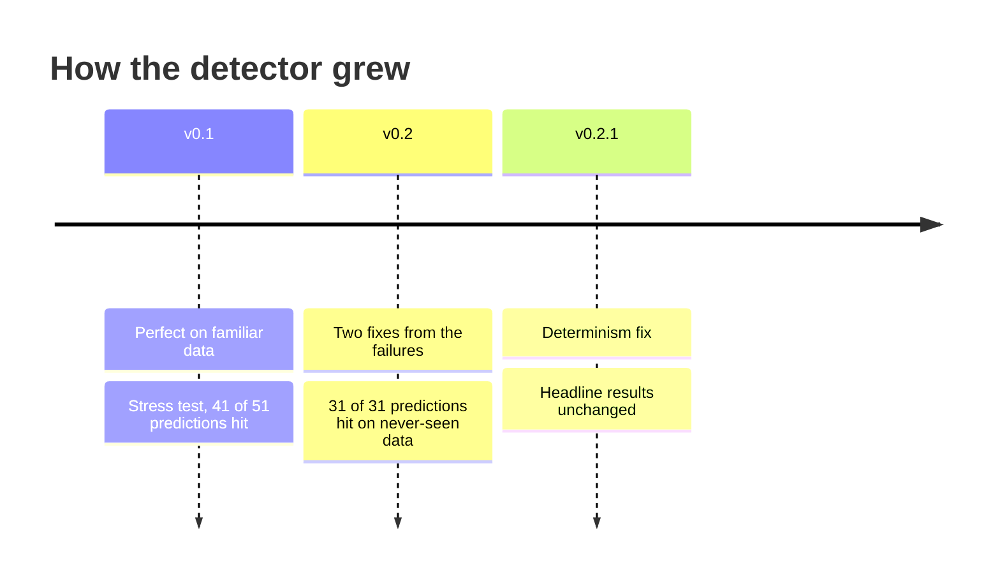

| Version | The problem it faced | What changed | Outcome |
|---|---|---|---|
| **v0.1** | Scored 1.000 on familiar *and* unseen seeds, but every seed came from our own generator, so the test might simply be too easy | Frozen, then stress-tested on 15 scenarios with **predictions pushed to git before any stress code existed** | 41 of 51 predictions hit; 10 misses published with their causes |
| **v0.2** | Placeholder stories (`"N/A"`) glued up to 178 strangers together, dropping recall to 0. Values in other forms (`+1 555…`, `name+tag@…`) broke matches | A story needs at least 6 words; phones, emails, accounts and postcodes are matched on standard keys | **31 of 31** new predictions hit on seeds no version had seen |
| **v0.2.1** | Re-running a report changed one comparison row: Louvain's split depended on Python's random hash seed | Louvain runs on integer labels; a test checks three hash seeds | Results identical in every process |

<details>
<summary><b>The stress test in detail</b></summary>

<br/>

The method, in order (the git history proves it):

1. Write the scenarios and the predictions, then push them ([STRESS_PLAN.md](docs/STRESS_PLAN.md)).
2. Freeze the detector at commit `ddf09cc`.
3. Break the data: messy formats, typos, camouflaged rings, rings of 2 or 25, flatmates and blended families, missing data, placeholder text.
4. Score every prediction as hit or miss: v0.1 in [STRESS.md](docs/STRESS.md), v0.2 in [STRESS_V02.md](docs/STRESS_V02.md).

| Scenario | v0.1 | v0.2, never-seen seeds |
|---|---|---|
| Placeholder stories, all incidents | precision 0.000 · recall 0.000 | precision 0.992 · recall 0.833 |
| Identifier in another form | recall 0.74 to 0.86 | recall 1.000 at every strength |
| Normal data | 1.000 | 1.000, unchanged |

Still failing, documented on purpose: typos (no fuzzy guessing), heavily reworded stories, and flatmates or blended families with different surnames. Explaining those away would also hide real rings that share an address.

</details>

---

## 6. Results

Measured on the development seed and on five seeds the detector never saw ([docs/EVALUATION.md](docs/EVALUATION.md)):

| Measure | Development seed | 5 unseen seeds |
|---|---:|---:|
| Precision | 1.000 | 1.000 |
| Ring recall | 1.000 | 1.000 |
| False alarms on innocent look-alikes | 0.000 | 0.000 |
| Fraud groups ranked at the top | 1.000 | 1.000 |

All five edge cases pass, and all 341 IDs quoted in explanations exist in the data.

**Why each idea matters:** take one away and a number falls (mean of the unseen seeds).

| Approach | Precision | Ring recall |
|---|---:|---:|
| **FraudNet** | **1.000** | **1.000** |
| Without explaining away innocent causes | 0.970 | 0.825 |
| Without the repetition rule | 0.658 | 1.000 |
| Treating a shared provider as a link | 0.083 | 0.008 |
| Flag anyone who shares any value | 0.089 | 0.667 |
| Trust the recorded relationship register | 0.068 | 0.500 |

> Every seed, stress scenarios included, comes from this repository's generator. Perfect scores mean the documented patterns are separated cleanly, not that real-world fraud would be. That is what the stress test is for.

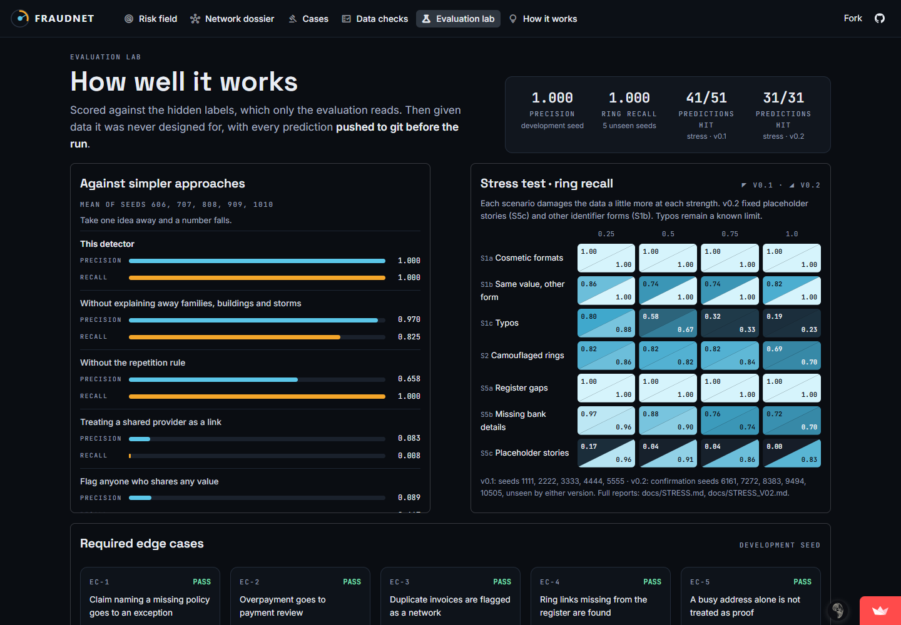

---

## 7. The app

Six pages, one question each. Open the **[live app](https://insurance-fraud-network-detection-kwxi3ptyqgqtvulnubi7bo.streamlit.app/)**; no sign-in is needed, and if it has been asleep it wakes in about a minute.

| Page | Question it answers |
|---|---|
| Risk field | What needs my attention first, and why? |
| Network dossier | Is this group really suspicious? Who is linked, and when did things happen? |
| Cases | What happens next, and who is allowed to decide? |
| Data checks | Can I trust the data? Which records broke the rules? |
| Evaluation lab | How well does it work, and where does it stop working? |
| How it works | What is this, in two minutes? |

<details>
<summary><b>Cases and the rules behind them</b></summary>

<br/>

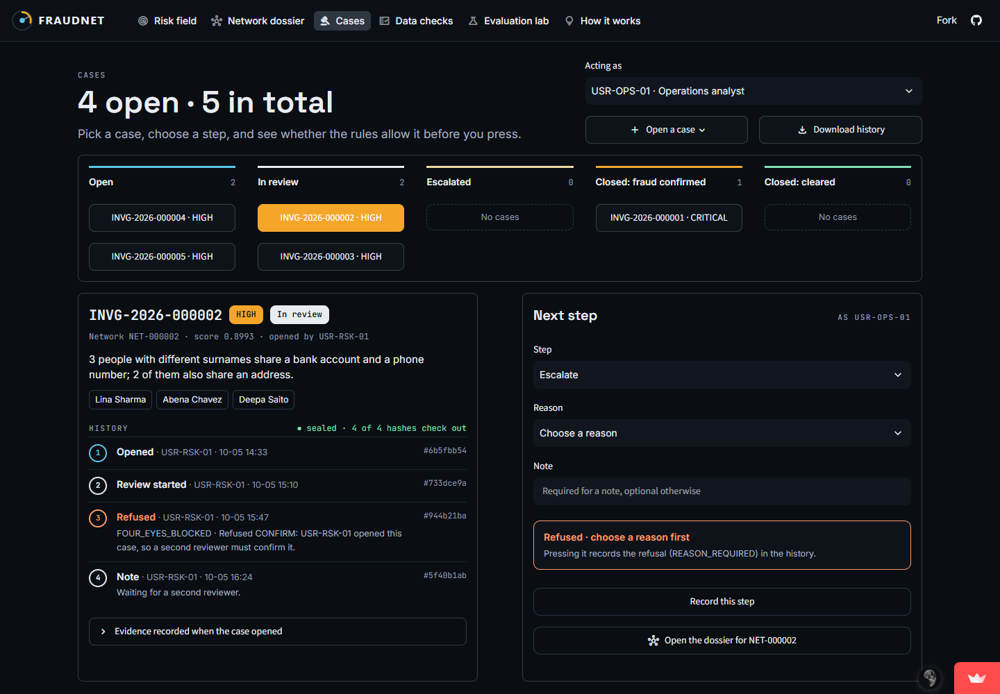

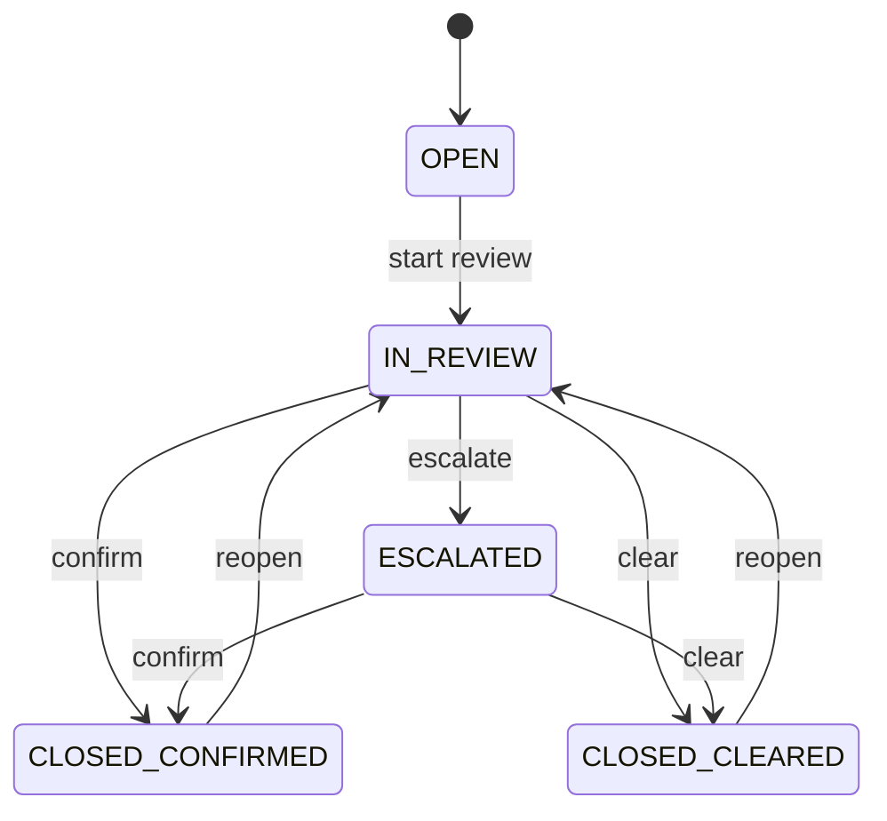

| Rule | Effect |
|---|---|
| Four-eyes | Whoever opened a case can never confirm it |
| Escalation | A CRITICAL case must be escalated before it closes |
| Analyst limit | Analysts may clear only LOW or MEDIUM cases |
| Refusals are recorded | A refused action is written to the history as BLOCKED |
| Sealed history | Triggers block edits and deletes; each event carries a SHA-256 hash of the one before |

</details>

<details>
<summary><b>Data checks and How it works</b></summary>

<br/>

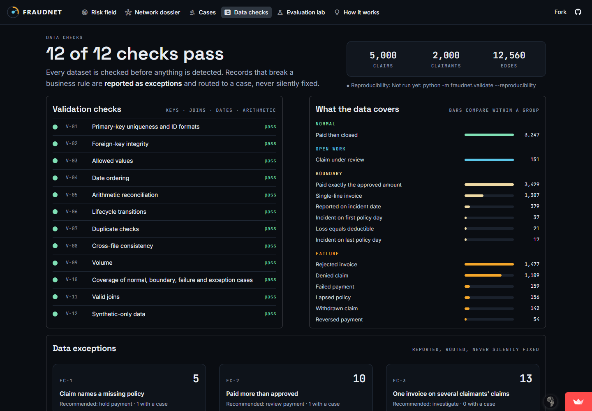

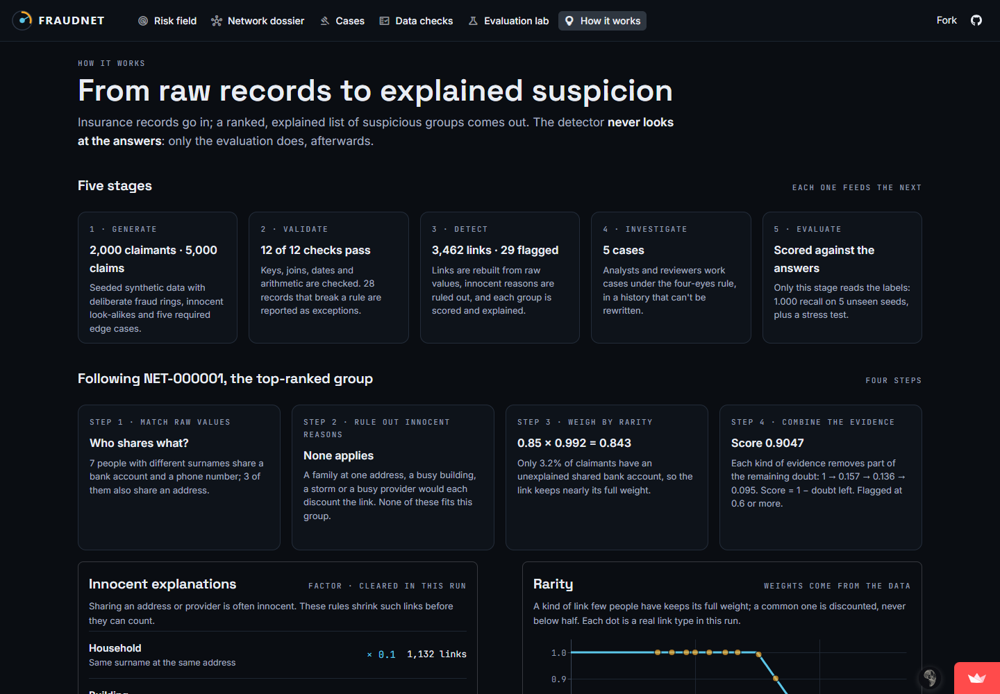

</details>

On the hosted copy the dataset is rebuilt on first start, and cases created there can reset when Streamlit restarts the app. **Download history** on the Cases page keeps them.

---

## 8. Key decisions

The choices that shaped the project most:

| Decision | Why |
|---|---|
| Evidence rules, not machine learning | The labels come from our own generator, so a trained model would learn the generator, not fraud |
| Answers physically separated and policed | An automatic check fails if detector or app code names a label file or column |
| Noisy-OR scoring | Evidence reinforces without passing 1, and every score can be broken down step by step |
| Predictions pushed before the stress test | The git history shows nothing was tuned to the answers |
| Four-eyes rule and a hash chain | Decisions must be auditable, including refused attempts |
| SQLite, rebuilt on start-up | One file, no external account, the same schema and triggers everywhere |
| Investigator-first app in plain language | One question per page; technical codes stay on the dossier |

---

## 9. Run it yourself

You need **Python 3.13 or newer** (check with `python --version`; on macOS and Linux the command is often `python3`). No accounts, keys or internet are needed after installing.

```bash
git clone https://github.com/dsservant28/Insurance-fraud-network-detection.git
cd Insurance-fraud-network-detection

python -m venv .venv
.venv\Scripts\activate              # Windows
# source .venv/bin/activate         # macOS / Linux

pip install -e .
pip install -r requirements-dev.txt

python -m fraudnet.run              # build everything: about 1.5 minutes
streamlit run streamlit_app.py      # open http://localhost:8501
```

To check everything:

```bash
pytest -q                           # 355 tests
python scripts/policy_check.py      # label separation, determinism, no secrets
```

<details>
<summary><b>Each stage on its own, and options</b></summary>

<br/>

| Stage | Command |
|---|---|
| Everything | `python -m fraudnet.run [--seed 20261022] [--scale 1.0] [--reproducibility] [--unseen-seeds 606 707 808 909 1010]` |
| Generate | `python -m fraudnet.generate --seed 20261022 --scale 1.0 --out data/output` |
| Validate | `python -m fraudnet.validate --data data/output --reproducibility` |
| Detect | `python -m fraudnet.detect --data data/output` |
| Investigate | `python -m fraudnet.investigate --data data/output {demo,list,verify,export FILE}` |
| Evaluate | `python -m fraudnet.evaluate --data data/output --seeds 606 707 808 909 1010 --doc docs/EVALUATION.md` |
| Stress test | `python -m fraudnet.evaluate stress --doc docs/STRESS.md` |

- **Scale:** `--scale 0.1` builds a quick starter dataset with the same generator.
- **Outputs:** each run writes CSV, JSON and SQL exports, a source manifest, a validation summary and a reproducibility report to `data/output/`.
- **The app's data:** the app reads `data/output`, or the committed sample in `data/sample`. Set `FRAUDNET_DATA` to point it elsewhere.

</details>

---

## 10. Reference

| Document | What's inside |
|---|---|
| [ARCHITECTURE.md](docs/ARCHITECTURE.md) | Detection theory, pipeline, scoring, workflow, limits |
| [DATA_DICTIONARY.md](docs/DATA_DICTIONARY.md) | Every table and field, keys, planting rules, metrics |
| [EVALUATION.md](docs/EVALUATION.md) | Measured results and comparisons |
| [STRESS_PLAN.md](docs/STRESS_PLAN.md), [STRESS.md](docs/STRESS.md), [STRESS_V02.md](docs/STRESS_V02.md) | The stress test: predictions first, then results |
| [AI_USAGE.md](docs/AI_USAGE.md) | How AI assistance was used |

<details>
<summary><b>Requirements traceability: every line of the brief, and where it's met</b></summary>

<br/>

| Problem statement | Where it is met |
|---|---|
| Master data first; children use valid parent IDs | `generate/pipeline.py` order; validation V-02 and V-11 |
| Providers, invoices, payments; shared contacts, repeated narratives, unusual timing; hidden labels | `generate/plant.py`, `transactions.py`, `lifecycle.py`; `hidden/ground_truth.csv` and `.json` |
| State changes as records; history never overwritten | `*_events` tables; append-only `investigation_events` with triggers and a hash chain |
| Labels from documented rules | Every label has a `rule_id` and a reason (DATA_DICTIONARY section 8) |
| Entities, keys, cardinality, bridge tables, effective dates, lifecycles | DATA_DICTIONARY sections 3 to 5; SQLite STRICT schema |
| ID formats `CLM-2026-000001`, `INC-…`, `PRV-…`, `INV-PRV-<provider>-…`, `INVG-2026-…` | `generate/ids.py`; validation V-01 |
| Step 1: data dictionary | [docs/DATA_DICTIONARY.md](docs/DATA_DICTIONARY.md) |
| Step 4: 5,000 claims, 2,000 claimants, 500 providers, at least 8,000 edges; fixed seed; scale | 5,000 · 2,000 · 500 · 12,560; `--seed`, `--scale` |
| Step 5: five edge cases | EC-1 to EC-5, all pass |
| Step 6: derived values computed | `generate/lifecycle.py`; validation V-05 |
| Step 7: separate ground truth, never leaked | `hidden/`; `scripts/policy_check.py`; byte-identical detector output with the labels removed |
| Step 8: PK, FK, enums, dates, arithmetic, lifecycle, duplicates | `python -m fraudnet.validate`: V-01 to V-12, all pass |
| Step 9: CSV, JSON, SQL, README, dictionary, command, seed, manifest, validation summary | `data/output/input/`, `data/output/reports/`, this README |
| Step 10: regenerate twice and compare | `--reproducibility`: 41 of 41 files identical |
| Planted patterns rank highly | R-precision 1.000 |
| Explanations reference evidence | 341 cited IDs, all found |
| False-positive and false-negative rates measurable | [EVALUATION.md](docs/EVALUATION.md), [STRESS_V02.md](docs/STRESS_V02.md) |
| Actors: customer, operations analyst, risk reviewer, administrator | Claimant data; `OPS_ANALYST`, `RISK_REVIEWER`, `SYS_ADMIN` roles (demo users) |
| Lawful use | Synthetic data only; validation V-12 |

</details>

<details>
<summary><b>Repository layout</b></summary>

<br/>

```
src/fraudnet/
  generate/      seeded generator, planting rules, labels, exports
  validate/      12 checks, data exceptions, reproducibility
  detect/        link rebuilding, scoring, explanations (never reads labels)
  evaluate/      metrics, comparisons, stress test (the only reader of labels)
  investigate/   cases, roles, append-only hash-chained history
  app/           the Streamlit app (never reads labels)
  run.py         one command for every stage
streamlit_app.py the app's entry point
tests/           355 tests
docs/            dictionary, architecture, decisions, reports, screenshots
data/sample/     committed small sample (data/output is rebuilt, never committed)
scripts/         policy_check.py
```

</details>

---

<div align="center">
<sub>Built for the YottaFlex AI Associate AI Forward Deployed Engineer challenge by Jagadeep Varma Penmetsa.<br/>
Synthetic data only, with no real people. AI assistance is disclosed in <a href="docs/AI_USAGE.md">docs/AI_USAGE.md</a>.</sub>
</div>
