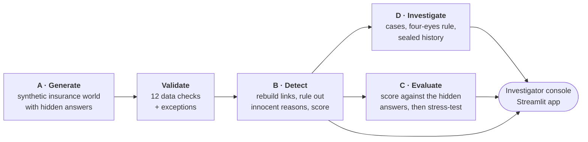
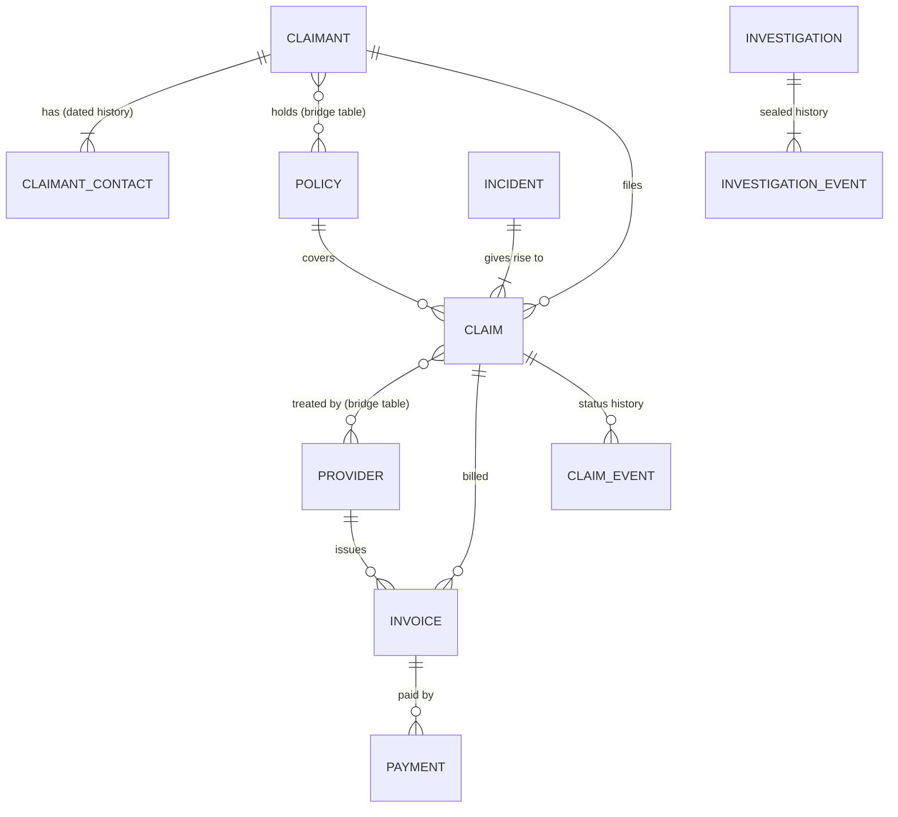
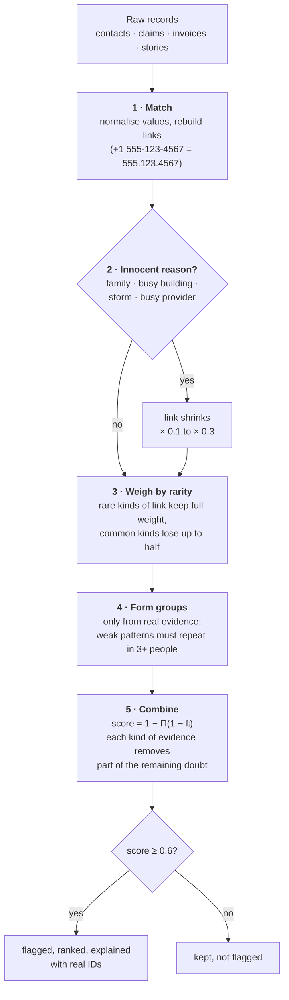
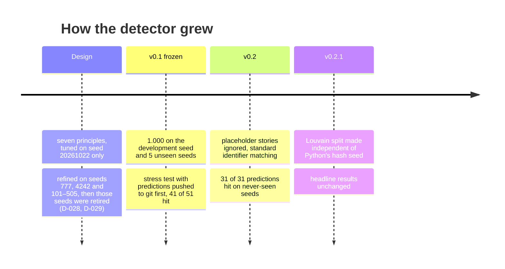
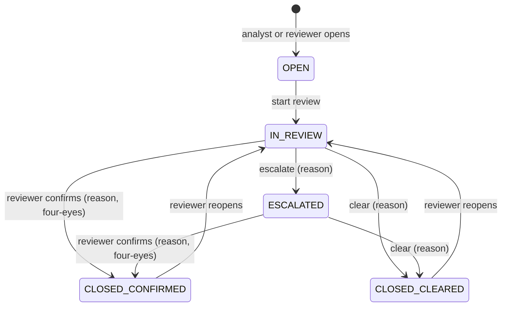

<div align="center">

# FraudNet

**Finding insurance fraud rings: groups of people who quietly share bank accounts, phones and stories, without mistaking ordinary families for criminals.**

### [▶ Open the live app](https://insurance-fraud-network-detection-kwxi3ptyqgqtvulnubi7bo.streamlit.app/)

<sub>https://insurance-fraud-network-detection-kwxi3ptyqgqtvulnubi7bo.streamlit.app/ · no sign-in needed · if it has been asleep, click "wake up" and give it about a minute</sub>

[](https://insurance-fraud-network-detection-kwxi3ptyqgqtvulnubi7bo.streamlit.app/)
&nbsp;

&nbsp;

&nbsp;


<sub>The investigator's first screen: the 29 groups that need a human, highest risk first, each with a one-line reason.</sub>

</div>

---

## The problem, in one minute

An insurer pays thousands of claims. Most are honest. A few are not, and the worst ones are not single liars but **rings**: a handful of people who file separate claims that look normal on their own, while secretly sharing a bank account, a phone number, a body shop, or a suspiciously similar story.

You can't see a ring by looking at one claim. You have to **connect the dots** between claimants, policies, incidents, providers and payments.

The catch is that connecting dots is easy, and most connected dots are innocent:

| These people share something... | ...and it's usually innocent |
|---|---|
| An address | A family, or a big apartment building |
| A phone or an account | A household |
| The same repair shop | It's the busiest shop in town |
| Similar stories, same week | A storm hit the whole street |

A naive "flag anyone who shares anything" approach drowns investigators in false alarms. We measured it: **fewer than 1 in 10** of the groups it flags are real fraud (see [Results](#results)).

So the real job is this: **link everything, explain away the innocent reasons, and surface only the groups that are left, each with evidence an investigator can check.**

That is the brief this project answers. The full problem statement is in [docs/problem_statement.md](docs/problem_statement.md).

---

## What we built



| Part | In one sentence | Where |
|---|---|---|
| **A. Generator** | Builds a realistic, seeded insurance world with fraud rings, innocent look-alikes and five tricky edge cases, and writes the answers to a separate hidden file. | `src/fraudnet/generate/` |
| **Validation** | Checks every key, join, date, sum and lifecycle, and reports rule-breaking records as exceptions instead of hiding them. | `src/fraudnet/validate/` |
| **B. Detector** | Finds suspicious groups from raw data alone. It **never reads the answers**, and that is enforced by an automatic check. | `src/fraudnet/detect/` |
| **C. Evaluation** | The only part allowed to read the answers. It measures precision, recall and false alarms, then tests the detector on data it was never designed for. | `src/fraudnet/evaluate/` |
| **D. Investigation** | Opens cases, enforces who may decide what, and keeps a history that can't be edited. | `src/fraudnet/investigate/` |
| **App** | Six pages for an investigator: queue, dossier, cases, data checks, evaluation, explainer. | `src/fraudnet/app/` |

---

## The data world

The generator builds **2,000 claimants, 2,600 policies, 5,000 claims, 500 providers and 12,560 recorded relationships** from a single seed (`20261022`). Parents are always created before children, every total is calculated rather than invented, and the same seed gives byte-identical files.



Hidden inside that world, with every label written to `hidden/ground_truth.csv` by a documented rule:

- **24 fraud rings** in six patterns: shared contacts, repeated stories, suspicious timing, provider collusion, staged crashes, and links missing from the records.
- **Almost 400 innocent look-alike groups:** 150 families, 200 honest repeat claimants, 20 people who moved into a former tenant's home, 10 busy buildings, 3 storms and 10 popular providers.
- **The five required edge cases:**
  - EC-1: a claim naming a policy that doesn't exist.
  - EC-2: a payment above the approved amount.
  - EC-3: one invoice billed to several claimants.
  - EC-4: ring links missing from the relationship register.
  - EC-5: a busy address that must *not* count as proof.

Field-by-field details: [docs/DATA_DICTIONARY.md](docs/DATA_DICTIONARY.md).

---

## How the detector thinks

The detector follows seven principles. Each one exists because a simpler approach failed in a specific way, and the evaluation proves what each adds.



<details>
<summary><b>The seven principles, in plain words</b> (click to open)</summary>

| # | Principle | Why it's there |
|---|---|---|
| P1 | **Rebuild links from raw values** and never trust the relationship register as given | The register is incomplete by design (EC-4): 45 links of the top ring were missing from it |
| P2 | **Identifiers beat addresses.** A shared bank account is strong evidence; a shared address is weak | Many unrelated people share a building; few share an account |
| P3 | **Explain away innocent causes** before anything counts | Families, buildings, storms and busy shops cause most coincidences |
| P4 | **A shared provider means nothing by itself**, only together with a shared anomaly | Everyone uses the popular body shop |
| P5 | **Weak patterns must repeat**: similar stories or early claims need 3 or more people | Two similar stories can be chance; seven can't |
| P6 | **Rarity sets the weights**, from this dataset and never from the answers | A link 3% of people have says more than one 20% have |
| P7 | **Groups form only from evidence links**; oversized groups are split with Louvain | Context such as a shared provider must never chain strangers together |

The full theory, with every threshold: [docs/ARCHITECTURE.md](docs/ARCHITECTURE.md).

</details>

### A worked example: the top-ranked group

Here is how **NET-000001** gets its score of **0.9047**:

| Step | What happens | Number |
|---|---|---|
| 1. Match | 7 people with **7 different surnames** share bank account `ACCT-66634749` and phone `555-605-3271`; 3 of them also share an address | — |
| 2. Innocent reason? | Different surnames, so not a family. Only 3 residents, so not a building. The provider isn't busy. **None applies.** | — |
| 3. Rarity | Only 3.2% of claimants have an unexplained shared account | 0.85 × 0.992 = **0.843** |
| 4. Combine | Doubt left after each kind of evidence: 1 → 0.157 → 0.136 → **0.095** | score = 1 − 0.095 = **0.9047** |

The timeline then shows why a human should care: **all 7 people reported an incident on the same day** (9 July 2026), and 10 invoices reached the same provider within six weeks.


---

## The journey: v0.1 → v0.2 → v0.2.1

Perfect scores are easy when you built both the test and the answer. This section is the honest part: how we tried to break our own detector, what broke, and how we fixed it.



### v0.1: perfect, and suspicious

v0.1 scored **1.000 precision and 1.000 recall** on the development seed *and* on five seeds it had never seen. That sounds great, but every seed came from our own generator, so the result only proved the detector separates patterns it was designed for.

So we stress-tested it, and did it the strict way:

1. **Predict first.** We wrote 15 scenarios and 24 numeric predictions (51 checks), and **pushed them to git before writing any stress code** ([STRESS_PLAN.md](docs/STRESS_PLAN.md)). The commit history proves the order.
2. **Freeze the detector** at commit `ddf09cc`.
3. **Break the data** in ways the design never saw: messy phone formats, typos, camouflaged rings, rings of 2 or of 25, flatmates and blended families, missing data, placeholder text.

**41 of 51 predictions hit.** The 10 misses are published with their causes ([STRESS.md](docs/STRESS.md)). The two worst failures:

| What broke | What happened in v0.1 | Why |
|---|---|---|
| **Placeholder stories** (`"N/A"`, `"See attached report."`) | Recall **0.00**, precision **0.00** | Identical placeholders at one provider looked like "the same story", gluing up to 178 strangers into one network and swallowing the real rings |
| **Same value, different form** (`+1 555…`, `name+claims@…`, `ACCT 0001…`, ZIP+4) | Recall fell to **0.74**, families became false alarms | Exact matching missed the shared value, so the "family" explanation stopped applying |

### v0.2: two targeted fixes

- **A story needs words:** a narrative with fewer than 6 distinct words is not a story.
- **Standard identifier rules:** phones matched on their last 10 digits, email `+tags` dropped, bank numbers compared on letters and digits only, postal codes on their first 5 digits.

Then the same discipline again: **new predictions pushed first**, scored on **five confirmation seeds no version had seen**.

| Scenario | v0.1 | v0.2 (never-seen seeds) |
|---|---|---|
| Placeholder stories, all incidents | precision 0.000 · recall 0.000 | precision **0.992** · recall **0.833** |
| Identifier in another form | recall 0.74–0.86 | recall **1.000** at every strength |
| Normal data | 1.000 | **1.000**, unchanged |
| Predictions hit | 41 / 51 | **31 / 31** |

Still failing, on purpose and documented: **typos** (exact matching, no fuzzy guessing), **heavily reworded stories**, and **flatmates or blended families with different surnames**. We chose not to explain those away, because doing so would also hide real rings that share an address ([D-032](docs/DECISIONS.md)).

### v0.2.1: a bug found by re-running a report

Rebuilding the evaluation changed one comparison row with no code change. The cause: networkx's Louvain iterates Python sets, and Python randomises string hashing per process, so very large groups could split differently from run to run. The fix runs Louvain on integer labels; a test now runs it under three different hash seeds and requires the same answer. The detector's normal output was unaffected, since no normal group is that large ([D-035](docs/DECISIONS.md)).

---

## Results


**On the development seed and 5 unseen seeds** ([docs/EVALUATION.md](docs/EVALUATION.md)):

| Measure | Dev seed | Unseen seeds (mean) |
|---|---:|---:|
| Precision | 1.000 | 1.000 |
| Ring recall | 1.000 | 1.000 |
| False-positive rate on innocent look-alikes | 0.000 | 0.000 |
| R-precision (fraud groups at the top) | 1.000 | 1.000 |
| Group match quality (Jaccard) | 0.987 | 0.994 |

All five edge cases pass, and every one of the 341 IDs quoted in explanations exists in the data.

**Why the design matters.** Take one idea away and a number falls (unseen-seed means):

| Approach | Precision | Ring recall |
|---|---:|---:|
| **FraudNet** | **1.000** | **1.000** |
| Without explaining away innocent causes (P3 off) | 0.970 | 0.825 |
| Without the repetition rule (P5 off) | 0.658 | 1.000 |
| Treating a shared provider as a link (P4 off) | 0.083 | 0.008 |
| Flag anyone who shares any value | 0.089 | 0.667 |
| Trust the recorded relationship register | 0.068 | 0.500 |

> **Honest reading.** Every seed, stress scenarios included, comes from this repository's generator. Perfect scores mean the documented patterns are separated cleanly, not that real-world fraud would be. The stress test is there to show where the method stops working.

---

## The investigator console

Six pages, one job each. Live at **[insurance-fraud-network-detection….streamlit.app](https://insurance-fraud-network-detection-kwxi3ptyqgqtvulnubi7bo.streamlit.app/)**.

| Page | Answers the question | |
|---|---|---|
| **Risk field** | What needs my attention first, and why? | Ranked queue with one-line reasons, plus a clickable score map |
| **Network dossier** | Is this group really suspicious? | Live link graph, how the score was built, evidence, timeline |
| **Cases** | What happens next, and who may decide? | Case board, rule check before you press, sealed history |
| **Data checks** | Can I trust the data? | 12 checks, coverage, every exception |
| **Evaluation lab** | How well does it work? | Comparisons, stress grid, edge cases |
| **How it works** | What is this, in two minutes? | Pipeline, one real walkthrough, honesty checks |

<details>
<summary><b>See the Cases page and the case rules</b></summary>




- **Four-eyes rule:** whoever opened a case can never confirm it.
- **Escalation and limits:** CRITICAL cases must be escalated before they close. Analysts may clear only LOW or MEDIUM cases.
- **Refusals are recorded:** a refused action is written into the history as a BLOCKED event, never silently dropped.
- **History can't be rewritten:** database triggers block every edit or delete, and each event carries a SHA-256 hash of the one before it.

</details>

<details>
<summary><b>See the Data checks and How it works pages</b></summary>


</details>

> The hosted app rebuilds its dataset on first start (about a minute), and cases created there can reset when Streamlit restarts the app. Use **Download history** on the Cases page to keep them.

---

## Key decisions

Every design choice is written down with the options considered and the trade-off accepted, in **[docs/DECISIONS.md](docs/DECISIONS.md)** (35 decisions). The ones that shaped the project most:

| Decision | Why |
|---|---|
| **Evidence rules, not machine learning** (D-022) | The labels come from our own generator, so a trained model would partly learn the generator rather than fraud. Labels are used only to measure. |
| **Labels physically separated and policed** (D-011) | An automatic check fails the build if detector or app code mentions a label file or column, and a test deletes the labels and gets byte-identical detector output. |
| **Noisy-OR scoring** (D-024) | Independent kinds of evidence reinforce each other, but never add up past 1, and every score can be broken down step by step. |
| **Predictions pushed before the stress test** (D-031) | It's the only way a perfect score can be trusted: the git history shows we didn't tune to the answers. |
| **Four-eyes rule plus a hash chain** (D-026, D-030) | Investigation decisions must be auditable, including refused attempts. |
| **SQLite, rebuilt on start-up** (D-002, D-018) | One file, no external account, the same schema and triggers everywhere. |
| **Investigator-first app in plain language** (D-033, D-034) | One question per page; codes and IDs stay on the dossier, where someone actually investigates. |

---

## Run it yourself

**Requirements:** Python **3.13 or newer** and about a minute and a half. No accounts, no API keys, no internet once installed.
Check your version with `python --version`. On macOS and Linux the command is often `python3`; use that wherever you see `python` below.

```bash
git clone https://github.com/dsservant28/Insurance-fraud-network-detection.git
cd Insurance-fraud-network-detection
python -m venv .venv
.venv\Scripts\activate             # Windows    (macOS/Linux: source .venv/bin/activate)
pip install -e .                   # the package and its pinned dependencies
pip install -r requirements-dev.txt

python -m fraudnet.run             # generate → validate → detect → demo cases → evaluate
streamlit run streamlit_app.py     # open http://localhost:8501
```

Check everything:

```bash
pytest -q                          # 355 tests
python scripts/policy_check.py     # no label leakage, no unseeded randomness, no secrets
```

<details>
<summary><b>Every stage on its own, plus options</b></summary>

| Stage | Command |
|---|---|
| Everything | `python -m fraudnet.run [--seed 20261022] [--scale 1.0] [--reproducibility] [--unseen-seeds 606 707 808 909 1010]` |
| Generate | `python -m fraudnet.generate --seed 20261022 --scale 1.0 --out data/output` |
| Validate | `python -m fraudnet.validate --data data/output --reproducibility` |
| Detect | `python -m fraudnet.detect --data data/output` |
| Investigate | `python -m fraudnet.investigate --data data/output {demo,list,verify,export FILE}` |
| Evaluate | `python -m fraudnet.evaluate --data data/output --seeds 606 707 808 909 1010 --doc docs/EVALUATION.md` |
| Stress test | `python -m fraudnet.evaluate stress --doc docs/STRESS.md` |

- **Scale:** `--scale 0.1` makes a quick starter dataset with the same generator.
- **Outputs:** each run writes CSV, JSON and SQL exports, a source manifest, a validation summary and a reproducibility report under `data/output/`.
- **The app's data:** the app reads `data/output`, or the committed scale-0.1 sample in `data/sample`. Set `FRAUDNET_DATA` to point it elsewhere.

</details>

---

<details>
<summary><b>Requirements traceability: every line of the brief, and where it's met</b></summary>

| Problem statement | Where it is met |
|---|---|
| Master data first; children use valid parent IDs | `generate/pipeline.py` order; validation V-02 (foreign keys), V-11 (joins) |
| Providers, invoices, payments; shared contacts, repeated narratives, unusual timing; hidden labels | `generate/plant.py`, `transactions.py`, `lifecycle.py`; `hidden/ground_truth.csv` and `.json` |
| State changes as records, never overwrite history | `*_events` tables; `investigation_events` is append-only, with triggers and a hash chain |
| Labels from documented rules | Every label has a `rule_id` and a reason ([DATA_DICTIONARY.md](docs/DATA_DICTIONARY.md) section 8) |
| Entities, keys, cardinality, bridge tables, effective dates, lifecycles | [DATA_DICTIONARY.md](docs/DATA_DICTIONARY.md) sections 3–5; SQLite STRICT schema |
| IDs `CLM-2026-000001`, `INC-…`, `PRV-…`, `INV-PRV-<provider>-…`, `INVG-2026-…` | `generate/ids.py`; validation V-01 |
| Step 1: data dictionary | [docs/DATA_DICTIONARY.md](docs/DATA_DICTIONARY.md) |
| Step 4: 5,000 claims, 2,000 claimants, 500 providers, ≥ 8,000 edges; fixed seed; scale parameter | 5,000 / 2,000 / 500 / 12,560; `--seed`, `--scale` |
| Step 5: five edge cases | EC-1 to EC-5, all PASS |
| Step 6: derived values computed | `generate/lifecycle.py`; validation V-05 |
| Step 7: separate ground truth, never leaked | `hidden/`; `scripts/policy_check.py`; byte-identical test with labels removed |
| Step 8: PK, FK, enums, dates, arithmetic, lifecycle, duplicates | `python -m fraudnet.validate`: V-01 to V-12, all PASS |
| Step 9: CSV, JSON, SQL, README, dictionary, command, seed, manifest, validation summary | `data/output/input/{csv,json,sql}`, `reports/`, this README |
| Step 10: regenerate twice, compare checksums | `--reproducibility`: 41 of 41 files identical |
| Planted patterns rank highly | R-precision 1.000 |
| Explanations reference evidence | 341 cited IDs, all found in the input |
| FP and FN rates measurable | [EVALUATION.md](docs/EVALUATION.md), [STRESS_V02.md](docs/STRESS_V02.md) |
| Actors: customer, operations analyst, risk reviewer, administrator | Claimant data; `OPS_ANALYST`, `RISK_REVIEWER`, `SYS_ADMIN` roles (demo users, no login) |
| Lawful use | Synthetic only; built-in fictional value lists; validation V-12 |

</details>

<details>
<summary><b>Repository layout and documentation map</b></summary>

```
src/fraudnet/
  generate/      seeded generator, planting rules, labels, exports
  validate/      12 checks, data exceptions, reproducibility
  detect/        link rebuilding, scoring, explanations (never reads labels)
  evaluate/      metrics, comparisons, stress test (the only reader of labels)
  investigate/   cases, roles, append-only hash-chained history
  app/           the Streamlit console (reads detector output, never labels)
  run.py         one command for every stage
streamlit_app.py the app's entry point
tests/           355 pytest tests
docs/            dictionary, architecture, decisions, evaluation and stress reports
data/sample/     committed scale-0.1 sample (data/output is rebuilt, not committed)
scripts/         policy_check.py
```

| Document | What's inside |
|---|---|
| [ARCHITECTURE.md](docs/ARCHITECTURE.md) | Detection theory, pipeline, scoring, workflow, limits |
| [DATA_DICTIONARY.md](docs/DATA_DICTIONARY.md) | Every table and field, keys, planting rules, metrics |
| [DECISIONS.md](docs/DECISIONS.md) | 35 decisions with alternatives and trade-offs |
| [EVALUATION.md](docs/EVALUATION.md) | Measured results, comparisons, per-rule figures |
| [STRESS_PLAN.md](docs/STRESS_PLAN.md) → [STRESS.md](docs/STRESS.md) → [STRESS_V02.md](docs/STRESS_V02.md) | The stress test: predictions first, then v0.1 and v0.2 results |
| [AI_USAGE.md](docs/AI_USAGE.md) | How AI assistance was used |

</details>

---

## Limits we know about

- **Generated data only.** All data, including the stress scenarios, comes from this repository's generator.
- **Exact matching after clean-up.** A one-character typo in a phone or account breaks a link. Fuzzy matching was rejected because it would join strangers.
- **Different-surname households are flagged.** Flatmates or blended families who share an account look like a ring, and explaining them away would also hide real rings.
- **Rarity can be crowded out.** If one kind of sharing becomes very common, every link of that kind weighs less, real rings included.
- **Demo roles, not real logins.** Staff accounts are fixed demo users chosen in the app.

---

<div align="center">

Built for the YottaFlex AI Associate AI Forward Deployed Engineer challenge by **Jagadeep Varma Penmetsa**.<br/>
Synthetic data only, with no real people. AI assistance disclosed in [docs/AI_USAGE.md](docs/AI_USAGE.md).

</div>
