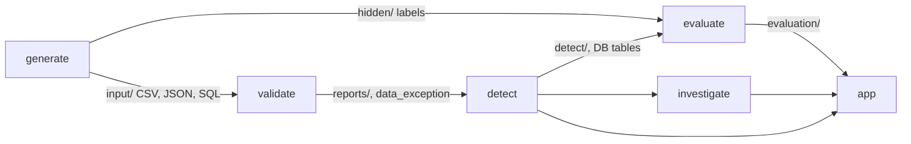
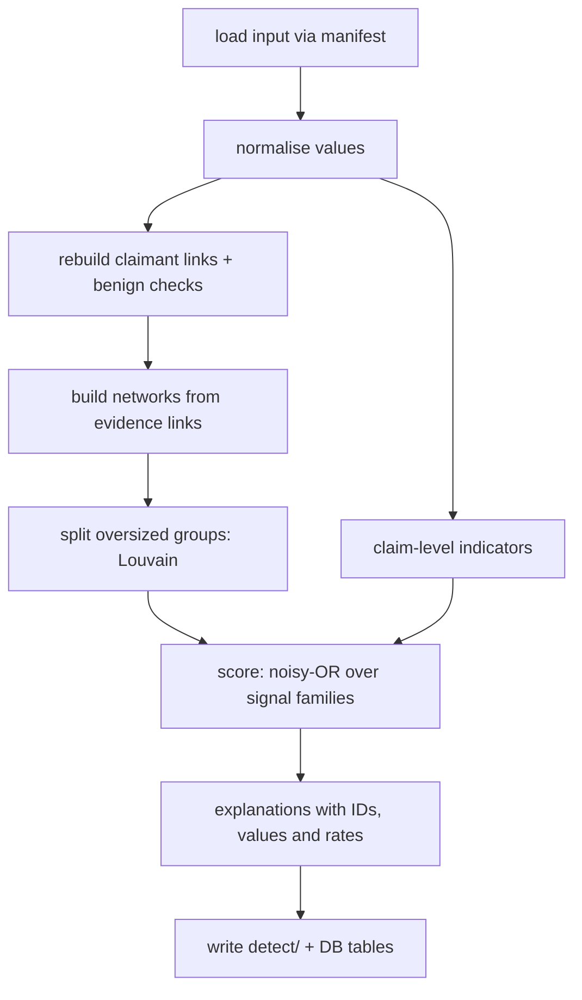
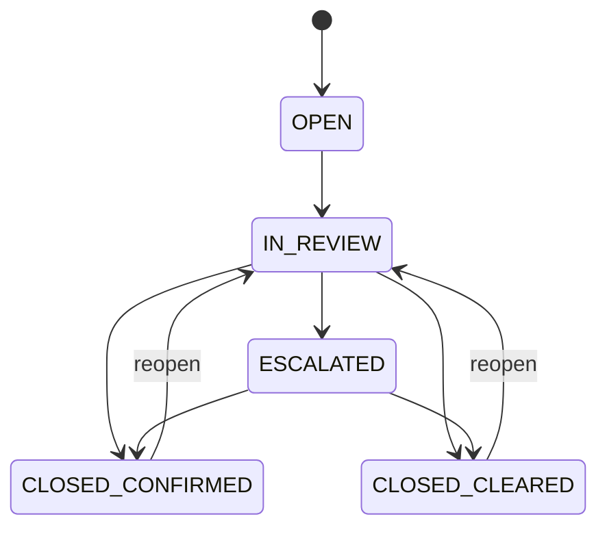

# Architecture

How the system finds fraud networks, why the method works, and how the parts fit together.
Field definitions are in `DATA_DICTIONARY.md`, and each choice's alternatives and trade-offs are in `DECISIONS.md` (D-022 to D-027).

---

## 1. System overview



| Stage | Reads | Writes | May read labels? |
|---|---|---|---|
| `generate` | Seed and scale | `input/`, `hidden/`, `reports/source_manifest.json` | Writes them |
| `validate` | `input/` | `reports/`, `data_exception` | No |
| `detect` | `input/` and `data_exception` | `detect/`, DB tables in section 4.5 | **No**, enforced three ways (section 7) |
| `evaluate` | `detect/` and `hidden/` | `evaluation/` | Yes. The only stage that may |
| `investigate` | Detector output and exceptions | `investigation`, `investigation_events`, `investigation_subject` | No |
| `app` | DB, `detect/`, `evaluation/` | Investigation events through `investigate` | Only the Evaluation page shows results that used labels |

- **One command** runs every stage: `python -m fraudnet.run --seed 20261022 --scale 1.0`. Each stage also has its own command.
- **Thresholds and weights** live in `src/fraudnet/detect/detector.toml`. Python reads it with the standard-library `tomllib`, and every run records the file's SHA-256.
- **Logic lives outside `app/`.** The Streamlit app only displays results and calls `investigate`, so an API could reuse the same code.

---

## 2. Detection theory

**The question:** which groups of claimants have links and behaviour too unusual to be coincidence, with no innocent explanation that accounts for them?

The detector answers it with seven principles. Each is a known method, and each was checked against the default-seed data before it was adopted (section 8).

| # | Principle | Rule in this system |
|---|---|---|
| P1 | **Entity resolution** | Links are rebuilt from raw values after normalising them (`12 Oak St` = `12 OAK STREET`), never taken from `relationship_edge`, and only where both contact periods overlap. Past tenants never link |
| P2 | **Identifier specificity** | A phone, email or bank account normally belongs to one household, while one address can legitimately hold many households. So identity matches are strong evidence and address matches weak |
| P3 | **Explaining away** | Before a link counts, the detector checks for a benign cause. A cause it finds lowers that link's strength, and the explanation is recorded |
| P4 | **Shared context needs a shared anomaly** | Using the same provider is not a link by itself. It becomes one only when both claims there share an anomaly: a near-identical story, or an early claim in the same window |
| P5 | **Repetition** | A weak pattern seen in one pair can be coincidence. Seen across three or more claimants, it is a pattern. Weak families count fully only when they link at least 3 claimants |
| P6 | **Rarity weighting** | A link's strength is scaled by how rare that link is in this dataset, so weights come from the data, not from the labels. Each explanation quotes the rate, for example *"only 1.4% of claimants share a bank account with an unrelated person"* |
| P7 | **Weak links don't chain** | Networks form only from evidence links. "Holds policy" and "used provider" never join people into a network. Groups that grow too large are split with Louvain community detection (fixed seed) |

### 2.1 Benign explanations (P3)

| Explanation | Test | Effect |
|---|---|---|
| **Household** | Same surname and same normalised address in overlapping periods | Identity link strength × 0.1 |
| **Building** (EC-5) | Address with at least 6 residents at the same time | Address link strength × 0.3 |
| **Common event** (storm) | Same incident type, same city and incident dates within 7 days | Story link strength × 0.2 |
| **Busy provider** | Provider's customer count above the dataset's 95th percentile | Provider-based links strength × 0.2. It does **not** apply to a story told by 3 or more of its customers who all match one another: a busy provider explains a coincidental pair, not a repeated story |
| **Ordinary crash** | Shared incident with only 2 claimants, or with 3 or more where no two parties are linked any other way | Not a link, or a link that joins nobody (section 3.3) |
| **Data error** | Orphan policy reference or overpayment | Routed as an exception, never scored as fraud |

---

## 3. Detector pipeline



### 3.1 Rebuilt links (`detected_edge`)
Each link joins two claimants or a claimant and a provider. It carries:
- its family and strength, plus any benign explanation applied
- the matched value and the source rows it came from
- the overlap period, and whether a matching link exists in `relationship_edge` (`in_recorded_edges`)

| Family | Link | Built from | Cap | Weak or strong |
|---|---|---|---:|---|
| `IDENTITY` | Shared bank, phone or email | `claimant_contact`, overlapping periods | 0.85 / 0.75 / 0.70 | Strong |
| `IDENTITY` | Claimant holds a provider's bank token | `claimant_contact` and `provider` | 0.85 | Strong |
| `BILLING` | Same provider invoice (number, date, total) on claims of different claimants | `invoice` | 0.80 | Strong |
| `STORY` | Near-identical narrative on different incidents at the same provider (P4) | `incident`, `claim_provider` | 0.65 | Weak |
| `TIMING` | Both claims early after policy start, at the same provider within 45 days (P4) | `claim`, `claim_provider` | 0.55 | Weak |
| `INCIDENT` | Same incident with 3 or more claimants | `claim` | 0.45 | Weak |
| `LOCATION` | Shared normalised address | `claimant_contact` | 0.20 | Weak |

**Narrative similarity** is IDF-weighted Jaccard over word sets with clock times removed. Words common to many narratives, such as template phrasing, count for little, while specific streets and details count for a lot. Plain word overlap was rejected because template text gives unrelated pairs 0.8 to 0.9 (section 8).

**A story needs words (v0.2).** A narrative with fewer than 6 distinct words, such as `N/A` or `See attached report.`, is not a story and makes no story links. In v0.1, identical placeholders at one provider linked every customer into one giant network. In the stress test this dropped ring recall to 0 (docs/STRESS.md, scenario S5c; D-032).

**Identifier rules (v0.2).** Values are matched on these keys:

| Identifier | Rule | Example of values that match |
|---|---|---|
| Phone | Last 10 digits | `+1 555-123-4567`, `001 555 123 4567`, `(555) 123-4567` |
| Email | Case-insensitive, with any `+tag` dropped | `Ann.Lee+claims@x.com`, `ann.lee@x.com` |
| Bank | Letters and digits only | `ACCT-00012345`, `acct 00012345` |
| Postal code | First 5 digits | `00123-0001`, `00123` |

These are standard data-matching rules. v0.1 missed them, and stress scenario S1b showed the cost. Single-character typos are still not matched: that needs fuzzy matching, which risks joining unrelated people (docs/STRESS.md, S1c).

### 3.2 Claim-level indicators (`fraud_indicator`)
These describe single claims and invoices. They add support to a network but never create one.

| Code | Rule |
|---|---|
| `CLAIM_BURST` | Network indicator for `EARLY_CLAIM_PAIR` links: claims within 10 days of policy start, at one provider, within 45 days of each other |
| `INFLATED_AMOUNT` | The network's invoices have a median at least 2× the peer median for the same incident type and provider type |
| `UNRECORDED_LINK` | A rebuilt evidence link is missing from `relationship_edge`. Adds support only, never creates a network |
| `PROVIDER_CONCENTRATION` | At least 3 members, and at least 60% of members, use one provider that is not busy. Not counted when a story or early-claim link already rests on that provider, because one fact can't count twice |
| `ORPHAN_POLICY_REF`, `PAYMENT_OVER_APPROVED`, `DUPLICATE_INVOICE` | Built from the input by the validator's exception rules. The first two are standalone, with score contribution 0, and route to exception cases. A duplicate invoice joins its network when one is flagged |

### 3.3 Networks
1. **Evidence links:** links with strength ≥ 0.15 after explanations, so explained household, building, storm and busy-provider links never join anyone. Two more rules apply P5 at joining time:
   - A shared incident links every party at once, so its links count only when at least two of its parties are also linked another way. Otherwise an ordinary three-car crash would attach bystanders to a ring member.
   - A provider-based weak link (story or early claim) whose provider has fewer than 3 such claimants joins nobody, unless another family links the same pair.
2. **Graph:** claimants are nodes, and evidence links are edges.
3. **Groups:** connected components.
4. **Splitting:** a component with more than 12 claimants is split with Louvain (resolution 1.0, seed from config), using strengths as weights.
5. **Members:** each network keeps at least 2 claimants. Providers and incidents that carry the evidence are added as context members (`member_role`: `LINKED_PROVIDER`, `SHARED_PROVIDER`, `BILLING_PROVIDER`, `SHARED_INCIDENT`).

### 3.4 Scoring
For each network and each family *f*:

```
link strength   = cap_f × rarity_f × explanation_factor
rarity_f        = clip(−log10(p_f) / 1.5, 0.5, 1.0)   p_f = share of claimants with an unexplained link of this type
family strength = strongest link × coverage            coverage = √(members touched / members)
                  × 0.5 if f is weak and links fewer than 3 claimants   (P5)
score           = 1 − Π (1 − family strength)          noisy-OR over families, plus SUPPORT (cap 0.3)
```

- **Why noisy-OR:** it treats each family as independent evidence. Two moderate families add up to more than either alone, but the score never exceeds 1, and adding members never raises it by itself.
- **`SUPPORT`** comes from claim-level indicators. It counts only when another family is present.
- **Flag rule:** score ≥ 0.6. Address, incident and timing evidence can never reach that alone. A story link already combines two facts (the same provider and a near-copied narrative), so it can flag alone, but only once it repeats across 3 or more claimants. Unexplained identity sharing or duplicate billing can stand alone. These properties are checked by a test (`test_flag_rule_needs_corroboration_for_weak_evidence`).
- **Priority:** CRITICAL ≥ 0.9, HIGH ≥ 0.8, MEDIUM ≥ 0.7, LOW otherwise. A flagged network between 0.6 and 0.7 is LOW priority. Networks are ranked by score, ties are broken by member count and then lowest claimant ID, and network IDs follow rank.
- **Initial values:** every number above starts here, is tuned on the default seed only, is stored in `src/fraudnet/detect/detector.toml`, and is reported on unseen seeds (section 5).

### 3.5 Explanations
Every network gets:
- a one-paragraph summary naming the claimant, provider, claim and invoice IDs, matched values and rates
- a score breakdown: each family's contribution and each explanation's reduction (shown as a waterfall in the app)
- a timeline of dates: policy start, incident, report, invoices and payments

Groups that look like a pattern but were cleared, such as households, buildings and storms, get a **"why this isn't suspicious"** note and the score they would have had without the explanation. They are written to `detect/cleared_groups.json` with IDs `CLR-000001` onwards. For example, a household sharing a phone and an address would score 0.84 without the household explanation.

---

## 4. Data contract of the detector

### 4.1 Run identity
`run_id = RUN-` + the first 12 hex characters of SHA-256 over (input manifest SHA-256, config SHA-256, code version). The same data and settings always give the same run ID and byte-identical output.

### 4.2 Files in `detect/`
`detector_run.json`, `detected_edge.csv`, `fraud_indicator.csv`, `network.csv`, `network_member.csv`, `cleared_groups.json` and `network_detail.json` (score breakdown, timeline and graph per network, for the app).

### 4.3 DB tables
`detector_run`, `detected_edge`, `network`, `network_member` and `fraud_indicator` are added to `fraudnet.db`, with FKs to `graph_node`. Field definitions are in DATA_DICTIONARY sections 3.9 and 4.3.

---

## 5. Evaluation design

| Practice | Plan |
|---|---|
| Development and test seeds | Tune only on seed 20261022. Report on unseen seeds 606, 707, 808, 909 and 1010 as mean ± standard deviation. Seeds 777 and 4242 (D-028) and 101-505 (D-029) were looked at during fixes, so they are retired |
| Matching | A network matches a labelled group when the claimant Jaccard is at least 0.5. Each group matches at most one network |
| Metrics | Precision, recall, false-positive rate on look-alikes, false-negative rate, precision@k, recall@k, average precision, R-precision and NDCG at N (N = number of fraud groups) |
| Comparison methods | (a) Flag any shared value. (b) Recorded edges only. (c) The full detector |
| One principle off at a time | No benign explanations; no repetition rule; provider as a plain link (P4 off) |
| Per rule | Recall per `R-RING-*` rule, false-positive rate per `B-*` rule |
| Edge cases | EC-1 to EC-3 found, EC-4 links recovered (`in_recorded_edges = 0`), EC-5 not flagged |
| Explanation check | Every flagged network has evidence, and every cited ID exists in the input |

**Targets set before measuring:** recall ≥ 0.9, look-alike false-positive rate ≤ 5%, and R-precision ≥ 0.85, on unseen seeds. The measured results are in `docs/EVALUATION.md`.

**Supervised learning is deliberately not used.** The labels come from this project's own generator, so a trained model would partly learn the generator rather than fraud. The labels are used only to measure.

### 5.1 Stress test: data the detector was not designed for

Perfect scores on seeds drawn the same way only show stability. The stress test (D-031) changes the data in 15 ways the design never saw. The scenarios cover messy identifiers, camouflaged rings, unusual ring sizes and counts, four kinds of innocent group the detector had never seen, missing or placeholder data, and a world with no fraud.

The protocol has four steps, and the git history shows them in this order:
1. **Predict first.** Every prediction was committed and pushed before any stress code or data existed (`docs/STRESS_PLAN.md`).
2. **Freeze the detector.** v0.1 was scored as frozen and hit 41 of 51 predictions (`docs/STRESS.md`). Its failures were placeholder narratives linking everyone (S5c) and identifier forms it didn't clean up (S1b).
3. **Register the fixes.** The fixes became v0.2 (D-032), with new predictions registered before v0.2 met any stress data (amendment A2).
4. **Score on new seeds.** v0.2 hit **31 of 31** on confirmation seeds no version had seen (`docs/STRESS_V02.md`).

On v0.1's own stress seeds, v0.2 is no worse than v0.1 by more than 0.02 in precision or recall in any of the 41 conditions (`docs/stress/STRESS_V02_same_seeds.md`).

| Scenario (v0.2, confirmation seeds) | Precision | Ring recall |
|---|---:|---:|
| No stress | 0.993 | 1.000 |
| Uncovered identifier forms, full strength (S1b) | 0.993 | 1.000 (v0.1: 0.817) |
| Placeholder narratives, full strength (S5c) | 0.992 (v0.1: 0.000) | 0.833 (v0.1: 0.000) |
| Single-character typos, half the fields (S1c) | 0.433 | 0.667 |
| Camouflaged rings, full strength (S2) | 0.789 (0.979 counting ring pieces) | 0.700 |
| Four times as many rings (S3c) | 0.996 | 0.729 |
| Blended families sharing a bank (S4b) | 0.583 | 0.992, with blended-family FP rate 1.000 |

The remaining failures are known and explained in the reports' failure gallery:
- **Typos:** a typo breaks an exact match.
- **Rewording:** reworded stories fall below the 0.85 similarity threshold.
- **Rarity crowding:** when a link type becomes common, every link of that type weakens.
- **Pairs:** two-person story rings are missed by design.
- **Innocent co-residents:** innocent people with different surnames sharing a home and account are flagged.

---

## 6. Investigation workflow



**Triggers:** `NETWORK_SCORE` for a flagged network, or `DATA_EXCEPTION`, which is the required exception path (EC-1 to an exception case).

| Role | May do |
|---|---|
| `OPS_ANALYST` | Open, start review, add a note, escalate, clear a LOW or MEDIUM case that is not escalated |
| `RISK_REVIEWER` | Confirm or clear, handle escalations, reopen |
| `SYS_ADMIN` | Run data loads and detection. Makes no case decisions |
| `CUSTOMER` | Appears only in claim history (submits or withdraws). Has no case access |

**Business rules**
- **Four-eyes rule:** the person who opened a case can't close it as confirmed.
- **Refused actions are recorded:** every refused action by case staff is written as a `BLOCKED` event with its reason (`FOUR_EYES_BLOCKED`, `ROLE_NOT_ALLOWED`, `INVALID_TRANSITION`, `ESCALATION_REQUIRED`, `ANALYST_LIMIT`, `REASON_REQUIRED`), so the history shows what was tried as well as what happened. System administrators are refused before any event is written.
- **One active case:** a network or exception has at most one case that isn't closed.
- **Demo staff:** synthetic accounts `USR-OPS-01/02`, `USR-RSK-01/02` and `USR-ADM-01` (`src/fraudnet/investigate/workflow.py`).
- **Critical cases:** a CRITICAL case must be escalated before it can close.
- **Reasons:** every closing and reopening needs a reason code.
- **Exception cases:** a `PAYMENT_OVER_APPROVED` case recommends a payment review. An `ORPHAN_POLICY_REF` case recommends holding payment.
- **History:** `investigation_events` is append-only, and database triggers block `UPDATE` and `DELETE`. Each event also stores the SHA-256 of the previous event plus its own content (`prev_hash`, `event_hash`), so the app can show that the history chain is intact. Cases keep a snapshot of their trigger and survive detector and validator reruns. Regenerating the data replaces the database, and the cases with it.
- **Commands:** `python -m fraudnet.investigate --data data/output {demo,list,verify,export FILE}`.

---

## 7. Keeping labels away from detection

1. **Code scan:** `scripts/policy_check.py` blocks label names and hidden-folder paths in `detect/`. It runs as a hook and in the tests.
2. **Removed-folder test:** a test runs the detector on a copy of `input/` with no `hidden/` folder and requires byte-identical output.
3. **Single loader:** the detector loads input only through `fraudnet.inputs.load_input`, which opens only the files listed in the input manifest.
4. **No generator shortcuts:** the detector never uses ID order, row order or file position, and network IDs are assigned by score order.
5. **Exploration disclosed:** labels were used only to look at signal behaviour on the development seed (section 8). Results are reported on seeds never used for this.

---

## 8. Design evidence (development seed 20261022, scale 1.0)

These counts were measured before the detector was written, and they are why each rule exists.

| Observation | Count | Rule it supports |
|---|---|---|
| Phones shared by claimants with the same surname | 63 values, all households | Household explanation (P3) |
| Phones, emails or banks shared across different surnames | 26 values, all inside fraud rings | Identity is strong (P2) |
| Unrelated narrative pairs with plain word overlap ≥ 0.8 | Thousands | Plain overlap rejected; IDF similarity used |
| Narrative pairs ≥ 0.85 (IDF) at the same provider | 71 inside R-RING-02 rings, 22 coincidental pairs | Story link needs the provider (P4) and repetition (P5) |
| Early-claim pairs at the same provider within 45 days | 47 inside R-RING-03 rings, 13 at small providers, 278 at busy providers | Busy-provider explanation (P3), shared anomaly (P4) |
| Incidents with 3 or more claimants | 28, including the 4 staged incidents | Incident is weak alone |
| Claims within 10 days of policy start | 5.3% of claims | Timing never flags alone |
| Reports within 1 day of the incident | 24.7% of claims | Not used as a signal |
| Customers per provider | Median 4, 99th percentile 199 | Busy-provider threshold from the data |

---

## 9. The app

**Concept:** "the investigator's console", a dark intelligence-room interface built on its own design system rather than default Streamlit styling.

| Page | Contents |
|---|---|
| Overview | Headline numbers and the ranked network queue with priority stamps |
| Network detail | Interactive graph (Cytoscape.js), score waterfall, evidence cards, timeline, explanation and "open case" |
| Claim explorer | Search one claim and see its policy, incident, invoices, payments and flags |
| Exceptions | `data_exception` rows and the route to a case |
| Case board | Cases in status columns, role switcher, four-eyes enforcement and the hash-chain check |
| Data quality | Validation and reproducibility results |
| Evaluation lab | Metrics, precision@k curve, seed stability, comparison methods and one-principle-off runs |
| Guided tour | Walks one ring end to end in about 60 seconds |

- **Graph:** Cytoscape.js is kept in the repository and embedded as a small custom component, so the hosted app needs no outside CDN.
  - **Edges:** coloured by family. Unrecorded links are dashed, and explained links are grey.
  - **Nodes:** shaped by entity type, and clicking one highlights its neighbours.
- **Design system:** one colour per signal family, used everywhere (graph, badges, charts). Custom theme, CSS, fonts and HTML components.
- **Hosting:** Streamlit Community Cloud (D-018). The app rebuilds the data and runs the detector at startup, then caches the result. It states that live cases can reset, and offers the case history as a download.

---

## 10. Limitations

- **Planted patterns only:** the detector is tested against the six fraud patterns this generator plants, so the results don't measure fraud in general.
- **Clean baseline contacts:** baseline contact values are unique (D-013), so in this data identity sharing outside households is rare. Real data has more noise. The stress test measures what that noise costs (section 5.1):
  - **Typos:** recall falls to 0.67 when half the fields have a typo.
  - **Shared business accounts:** company fleets reach a 10% false-alarm rate.
- **Exact matching:** identifiers are matched after standard clean-up, not fuzzily. A single-character typo breaks a link (stress scenario S1c).
- **Rarity crowding:** a link type's weight falls as it becomes common. That protects precision but can hide real rings once one kind of sharing is widespread (S3c, S4d).
- **Co-residents with different surnames:** flatmates and blended families who share a phone or an account are flagged. A co-resident explanation was rejected because it would weaken detection of address-sharing rings (D-032).
- **Explanation factors are judgement:** the household and building factors are documented judgement calls, and the one-principle-off runs show their effect.
- **Live cases can reset:** cases on the hosted app reset on restart (D-018).
