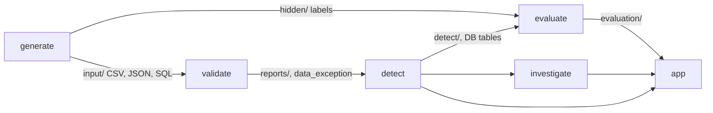
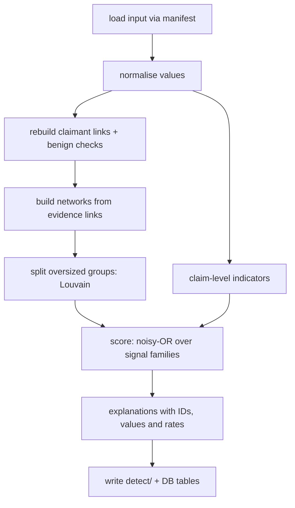
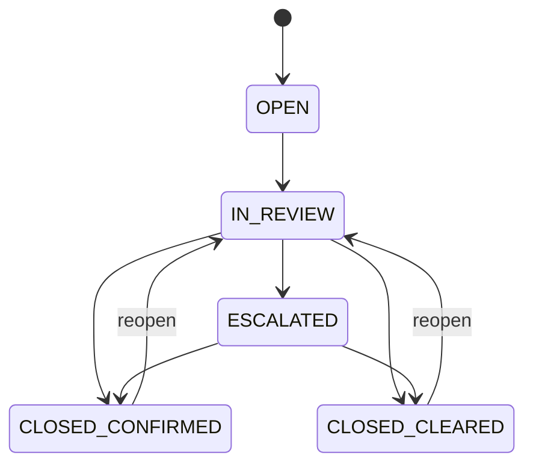

# Architecture

How the system finds fraud networks, why the method works, and how the parts fit together.
Field definitions are in `DATA_DICTIONARY.md`, and each choice's alternatives and trade-offs are in `DECISIONS.md` (D-022 to D-027).

---

## 1. System overview



| Stage | Reads | Writes | May read labels? |
|---|---|---|---|
| `generate` | Seed and scale | `input/`, `hidden/`, `reports/source_manifest.json` | Writes them |
| `validate` | `input/` | `reports/`, `data_exception` | No |
| `detect` | `input/` and `data_exception` | `detect/`, DB tables in section 4.5 | **No**, enforced three ways (section 7) |
| `evaluate` | `detect/` and `hidden/` | `evaluation/` | Yes. The only stage that may |
| `investigate` | Detector output and exceptions | `investigation`, `investigation_events`, `investigation_subject` | No |
| `app` | DB, `detect/`, `evaluation/` | Investigation events through `investigate` | Only the Evaluation page shows results that used labels |

- **One command** runs every stage: `python -m fraudnet.run --seed 20261022 --scale 1.0`. Each stage also has its own command.
- **Thresholds and weights** live in `src/fraudnet/detect/detector.toml`. Python reads it with the standard-library `tomllib`, and every run records the file's SHA-256.
- **Logic lives outside `app/`.** The Streamlit app only displays results and calls `investigate`, so an API could reuse the same code.

---

## 2. Detection theory

**The question:** which groups of claimants have links and behaviour too unusual to be coincidence, with no innocent explanation that accounts for them?

The detector answers it with seven principles. Each is a known method, and each was checked against the default-seed data before it was adopted (section 8).

| # | Principle | Rule in this system |
|---|---|---|
| P1 | **Entity resolution** | Links are rebuilt from raw values after normalising them (`12 Oak St` = `12 OAK STREET`), never taken from `relationship_edge`, and only where both contact periods overlap. Past tenants never link |
| P2 | **Identifier specificity** | A phone, email or bank account normally belongs to one household, while one address can legitimately hold many households. So identity matches are strong evidence and address matches weak |
| P3 | **Explaining away** | Before a link counts, the detector checks for a benign cause. A cause it finds lowers that link's strength, and the explanation is recorded |
| P4 | **Shared context needs a shared anomaly** | Using the same provider is not a link by itself. It becomes one only when both claims there share an anomaly: a near-identical story, or an early claim in the same window |
| P5 | **Repetition** | A weak pattern seen in one pair can be coincidence. Seen across three or more claimants, it is a pattern. Weak families count fully only when they link at least 3 claimants |
| P6 | **Rarity weighting** | A link's strength is scaled by how rare that link is in this dataset, so weights come from the data, not from the labels. Each explanation quotes the rate, for example *"only 1.4% of claimants share a bank account with an unrelated person"* |
| P7 | **Weak links don't chain** | Networks form only from evidence links. "Holds policy" and "used provider" never join people into a network. Groups that grow too large are split with Louvain community detection (fixed seed) |

### 2.1 Benign explanations (P3)

| Explanation | Test | Effect |
|---|---|---|
| **Household** | Same surname and same normalised address in overlapping periods | Identity link strength × 0.1 |
| **Building** (EC-5) | Address with at least 6 residents at the same time | Address link strength × 0.3 |
| **Common event** (storm) | Same incident type, same city and incident dates within 7 days | Story link strength × 0.2 |
| **Busy provider** | Provider's customer count above the dataset's 95th percentile | Provider-based links strength × 0.2 |
| **Ordinary crash** | Shared incident with only 2 claimants | Not a link |
| **Data error** | Orphan policy reference or overpayment | Routed as an exception, never scored as fraud |

---

## 3. Detector pipeline



### 3.1 Rebuilt links (`detected_edge`)
Each link joins two claimants or a claimant and a provider. It carries:
- its family and strength, plus any benign explanation applied
- the matched value and the source rows it came from
- the overlap period, and whether a matching link exists in `relationship_edge` (`in_recorded_edges`)

| Family | Link | Built from | Cap | Weak or strong |
|---|---|---|---:|---|
| `IDENTITY` | Shared bank, phone or email | `claimant_contact`, overlapping periods | 0.85 / 0.75 / 0.70 | Strong |
| `IDENTITY` | Claimant holds a provider's bank token | `claimant_contact` and `provider` | 0.85 | Strong |
| `BILLING` | Same provider invoice (number, date, total) on claims of different claimants | `invoice` | 0.80 | Strong |
| `STORY` | Near-identical narrative on different incidents at the same provider (P4) | `incident`, `claim_provider` | 0.65 | Weak |
| `TIMING` | Both claims early after policy start, at the same provider within 45 days (P4) | `claim`, `claim_provider` | 0.55 | Weak |
| `INCIDENT` | Same incident with 3 or more claimants | `claim` | 0.45 | Weak |
| `LOCATION` | Shared normalised address | `claimant_contact` | 0.20 | Weak |

**Narrative similarity** is IDF-weighted Jaccard over word sets with clock times removed. Words common to many narratives, such as template phrasing, count for little, while specific streets and details count for a lot. Plain word overlap was rejected because template text gives unrelated pairs 0.8 to 0.9 (section 8).

### 3.2 Claim-level indicators (`fraud_indicator`)
These describe single claims and invoices. They add support to a network but never create one.

| Code | Rule |
|---|---|
| `EARLY_CLAIM` | Incident within 10 days of policy start |
| `CLAIM_BURST` | Linked claimants' claims fall in a short window |
| `INFLATED_AMOUNT` | The network's invoices have a median at least 2× the peer median for the same incident type and provider type |
| `UNRECORDED_LINK` | A rebuilt evidence link is missing from `relationship_edge` |
| `PROVIDER_CONCENTRATION` | Network members' claims concentrate on one provider far beyond its share of all claims |
| `ORPHAN_POLICY_REF`, `PAYMENT_OVER_APPROVED`, `DUPLICATE_INVOICE` | Mirrored from `data_exception`. The first two are standalone and route to exception cases |

### 3.3 Networks
1. **Graph:** claimants are nodes, and edges are evidence links with strength ≥ 0.1 after explanations.
2. **Groups:** connected components.
3. **Splitting:** a component with more than 12 claimants is split with Louvain (resolution 1.0, seed from config), using strengths as weights.
4. **Members:** each network keeps at least 2 claimants. Linked providers, incidents and payments are added as context members (`member_role`).

### 3.4 Scoring
For each network and each family *f*:

```
link strength   = cap_f × rarity_f × explanation_factor
rarity_f        = clip(−log10(p_f) / 2, 0.5, 1.0)     p_f = share of claimants with this link type
family strength = strongest link × coverage            coverage = √(members touched / members)
                  × 0.5 if f is weak and links fewer than 3 claimants   (P5)
score           = 1 − Π (1 − family strength)          noisy-OR over families, plus SUPPORT (cap 0.3)
```

- **Why noisy-OR:** it treats each family as independent evidence. Two moderate families add up to more than either alone, but the score never exceeds 1, and adding members never raises it by itself.
- **`SUPPORT`** comes from claim-level indicators. It counts only when another family is present.
- **Flag rule:** score ≥ 0.6. No weak family can reach that alone, so a weak signal always needs corroboration (P4 and P5), while unexplained identity sharing or duplicate billing can stand alone.
- **Priority:** CRITICAL ≥ 0.9, HIGH ≥ 0.8, MEDIUM ≥ 0.7, LOW otherwise. Networks are ranked by score; ties are broken by member count, then lowest network ID.
- **Initial values:** every number above starts here, is tuned on the default seed only, is stored in `src/fraudnet/detect/detector.toml`, and is reported on unseen seeds (section 5).

### 3.5 Explanations
Every network gets:
- a one-paragraph summary naming the claimant, provider, claim and invoice IDs, matched values and rates
- a score breakdown: each family's contribution and each explanation's reduction (shown as a waterfall in the app)
- a timeline of dates: policy start, incident, report, invoices and payments

Groups that look like a pattern but were cleared, such as households, buildings and storms, get a **"why this isn't suspicious"** note. It is written to `detect/cleared_groups.json`.

---

## 4. Data contract of the detector

### 4.1 Run identity
`run_id = RUN-` + the first 12 hex characters of SHA-256 over (input manifest SHA-256, config SHA-256, code version). The same data and settings always give the same run ID and byte-identical output.

### 4.2 Files in `detect/`
`detector_run.json`, `detected_edge.csv`, `fraud_indicator.csv`, `network.csv`, `network_member.csv`, `cleared_groups.json` and `network_detail.json` (score breakdown, timeline and graph per network, for the app).

### 4.3 DB tables
`detector_run`, `detected_edge`, `network`, `network_member` and `fraud_indicator` are added to `fraudnet.db`, with FKs to `graph_node`. Field definitions are in DATA_DICTIONARY sections 3.9 and 4.3.

---

## 5. Evaluation design

| Practice | Plan |
|---|---|
| Development and test seeds | Tune only on seed 20261022. Report on 5 unseen seeds as mean ± standard deviation |
| Matching | A network matches a labelled group when the claimant Jaccard is at least 0.5. Each group matches at most one network |
| Metrics | Precision, recall, false-positive rate on look-alikes, false-negative rate, precision@k, recall@k, average precision, NDCG, and rings in the top N |
| Comparison methods | (a) Flag any shared value. (b) Recorded edges only. (c) The full detector |
| One principle off at a time | No benign explanations; no repetition rule; provider as a plain link (P4 off) |
| Per rule | Recall per `R-RING-*` rule, false-positive rate per `B-*` rule |
| Edge cases | EC-1 to EC-3 found, EC-4 links recovered (`in_recorded_edges = 0`), EC-5 not flagged |
| Explanation check | Every flagged network has evidence, and every cited ID exists in the input |

**Targets, not results until measured:** recall ≥ 0.9, look-alike false-positive rate ≤ 5%, and precision@24 ≥ 0.85, on unseen seeds.

**Supervised learning is deliberately not used.** The labels come from this project's own generator, so a trained model would partly learn the generator rather than fraud. The labels are used only to measure.

---

## 6. Investigation workflow



**Triggers:** `NETWORK_SCORE` for a flagged network, or `DATA_EXCEPTION`, which is the required exception path (EC-1 to an exception case).

| Role | May do |
|---|---|
| `OPS_ANALYST` | Open, start review, add a note, escalate, clear a LOW or MEDIUM case |
| `RISK_REVIEWER` | Confirm or clear, handle escalations, reopen |
| `SYS_ADMIN` | Run data loads and detection. Makes no case decisions |
| `CUSTOMER` | Appears only in claim history (submits or withdraws). Has no case access |

**Business rules**
- **Four-eyes rule:** the person who opened a case can't close it as confirmed. A blocked attempt is recorded as an event with reason `FOUR_EYES_BLOCKED`.
- **Critical cases:** a CRITICAL case must be escalated before it can close.
- **Reasons:** every closing and reopening needs a reason code.
- **Exception cases:** a `PAYMENT_OVER_APPROVED` case recommends a payment review. An `ORPHAN_POLICY_REF` case recommends holding payment.
- **History:** `investigation_events` is append-only, and database triggers block `UPDATE` and `DELETE`. Each event also stores the SHA-256 of the previous event plus its own content (`prev_hash`, `event_hash`), so the app can show that the history chain is intact.

---

## 7. Keeping labels away from detection

1. **Code scan:** `scripts/policy_check.py` blocks label names and hidden-folder paths in `detect/`. It runs as a hook and in the tests.
2. **Removed-folder test:** a test runs the detector on a copy of `input/` with no `hidden/` folder and requires byte-identical output.
3. **Single loader:** the detector loads input only through `fraudnet.inputs.load_input`, which opens only the files listed in the input manifest.
4. **No generator shortcuts:** the detector never uses ID order, row order or file position, and network IDs are assigned by score order.
5. **Exploration disclosed:** labels were used only to look at signal behaviour on the development seed (section 8). Results are reported on seeds never used for this.

---

## 8. Design evidence (development seed 20261022, scale 1.0)

These counts were measured before the detector was written, and they are why each rule exists.

| Observation | Count | Rule it supports |
|---|---|---|
| Phones shared by claimants with the same surname | 63 values, all households | Household explanation (P3) |
| Phones, emails or banks shared across different surnames | 26 values, all inside fraud rings | Identity is strong (P2) |
| Unrelated narrative pairs with plain word overlap ≥ 0.8 | Thousands | Plain overlap rejected; IDF similarity used |
| Narrative pairs ≥ 0.85 (IDF) at the same provider | 71 inside R-RING-02 rings, 22 coincidental pairs | Story link needs the provider (P4) and repetition (P5) |
| Early-claim pairs at the same provider within 45 days | 47 inside R-RING-03 rings, 13 at small providers, 278 at busy providers | Busy-provider explanation (P3), shared anomaly (P4) |
| Incidents with 3 or more claimants | 28, including the 4 staged incidents | Incident is weak alone |
| Claims within 10 days of policy start | 5.3% of claims | Timing never flags alone |
| Reports within 1 day of the incident | 24.7% of claims | Not used as a signal |
| Customers per provider | Median 4, 99th percentile 199 | Busy-provider threshold from the data |

---

## 9. The app

**Concept:** "the investigator's console", a dark intelligence-room interface built on its own design system rather than default Streamlit styling.

| Page | Contents |
|---|---|
| Overview | Headline numbers and the ranked network queue with priority stamps |
| Network detail | Interactive graph (Cytoscape.js), score waterfall, evidence cards, timeline, explanation and "open case" |
| Claim explorer | Search one claim and see its policy, incident, invoices, payments and flags |
| Exceptions | `data_exception` rows and the route to a case |
| Case board | Cases in status columns, role switcher, four-eyes enforcement and the hash-chain check |
| Data quality | Validation and reproducibility results |
| Evaluation lab | Metrics, precision@k curve, seed stability, comparison methods and one-principle-off runs |
| Guided tour | Walks one ring end to end in about 60 seconds |

- **Graph:** Cytoscape.js is kept in the repository and embedded as a small custom component, so the hosted app needs no outside CDN.
  - **Edges:** coloured by family. Unrecorded links are dashed, and explained links are grey.
  - **Nodes:** shaped by entity type, and clicking one highlights its neighbours.
- **Design system:** one colour per signal family, used everywhere (graph, badges, charts). Custom theme, CSS, fonts and HTML components.
- **Hosting:** Streamlit Community Cloud (D-018). The app rebuilds the data and runs the detector at startup, then caches the result. It states that live cases can reset, and offers the case history as a download.

---

## 10. Limitations

- **Planted patterns only:** the detector is tested against the six fraud patterns this generator plants, so the results don't measure fraud in general.
- **Clean baseline contacts:** baseline contact values are unique (D-013), so in this data identity sharing outside households is rare. Real data has more noise, such as typos and shared business numbers.
- **Explanation factors are judgement:** the household and building factors are documented judgement calls, and the one-principle-off runs show their effect.
- **Live cases can reset:** cases on the hosted app reset on restart (D-018).
